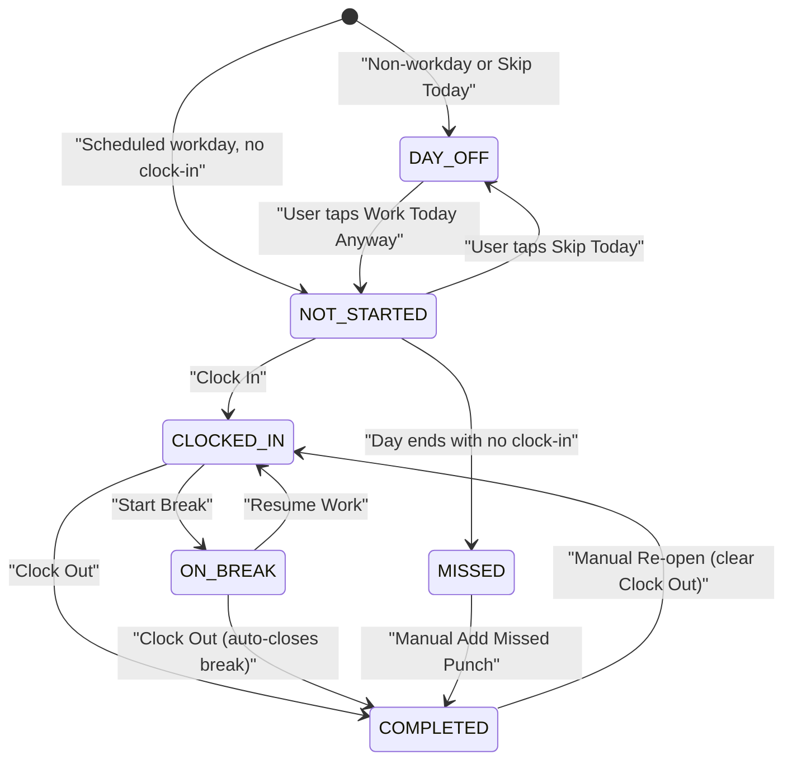
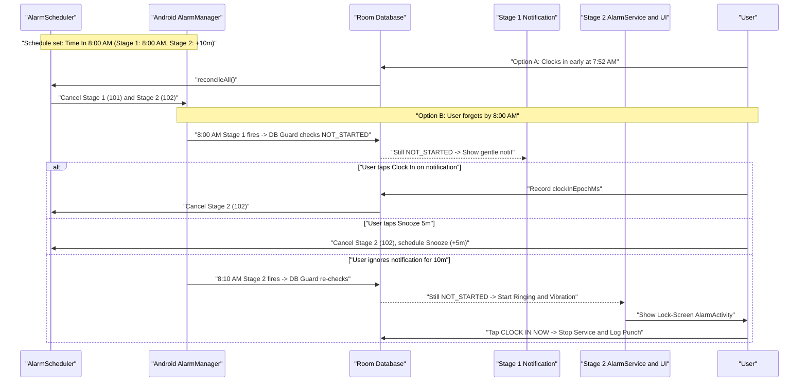

# App Flow — WorkHours

> Complete state transitions, reminder escalation sequences, and edge-case user journeys.

---

## 1. Daily Workday State Machine

Every calendar date (`YYYY-MM-DD`) resolves to one deterministic `WorkDayStatus`:

---

## 2. Two-Stage Escalating Reminder Sequence

---

## 3. Core User Flows

### Flow 1: First-Launch Onboarding
1. User opens app for the first time (`onboarding_completed == false`).
2. **Step 1 — Your Work Schedule:** Confirm or adjust default workdays (Mon–Fri), Clock In (`8:00 AM`), Clock Out (`5:00 PM`), and Break (`1h`).
3. **Step 2 — Make Reminders Reliable:** Guided permission checklist:
   - Grant **Notifications** (`POST_NOTIFICATIONS` on Android 13+).
   - Grant **Alarms & Reminders** (`SCHEDULE_EXACT_ALARM` on Android 12+ if not pre-granted).
   - Enable **Full-Screen Lock Alerts** (`USE_FULL_SCREEN_INTENT` on Android 14+ if needed).
   - Optional 1-tap button to exempt the app from aggressive **Battery Optimization** (helpful for Xiaomi/Samsung/Oppo phones).
4. **Step 3 — Quick Test & Finish:** Optional **"Test 5s Alert"** button, then **Start Tracking** -> lands on Dashboard and schedules the next 7 days of alarms.

### Flow 2: Standard Workday (In-App or Notification Actions)
1. **Morning (8:00 AM):** Stage 1 notification arrives: `"Time to Clock In (8:00 AM)"` with `[Clock In]` and `[Snooze 5m]` actions.
   - *Quick path:* User taps `[Clock In]` directly on the lock screen/notification shade -> toast/notification updates to `"Clocked in at 8:00 AM"`, Stage 2 alarm is cancelled, and Dashboard shows live timer.
2. **Lunch (12:00 PM):** User opens Dashboard (or uses Home/Dashboard) and taps **Start Break**.
   - Status turns Amber (`ON BREAK`), live break timer counts up, and `BREAK_END` Stage 1/2 reminders are scheduled relative to `now + defaultBreakMinutes` (e.g., 12:55 PM gentle, 1:05 PM escalate).
3. **Resume (1:00 PM):** User taps **Resume Work** (in-app or via notification action).
   - Break session closes, work timer resumes, and any remaining `BREAK_END` alarm cancels.
4. **Evening (5:00 PM):** `TIME_OUT` Stage 1 gentle notification fires. If ignored past grace window, Stage 2 vibrates/rings (`"Shift target reached — Clock Out?"`). User taps **Clock Out** -> `COMPLETED` state saved, chart updates immediately.

### Flow 3: Escalated Lock-Screen Alarm Handling
1. Stage 2 alarm fires while phone is locked and screen is off.
2. `AlarmActivity` wakes the screen and displays the event (`Clock In`, `Resume Work`, or `Clock Out`), scheduled time, and overdue minutes.
3. User choices:
   - **Primary (`CLOCK IN NOW` / `RESUME` / `CLOCK OUT`):** Stops audio/vibration, writes punch at current instant, cancels follow-up alarms for that event, and closes `AlarmActivity`.
   - **Snooze (`Snooze 5m`):** Stops audio/vibration and schedules a single snooze alarm for `now + snoozeMinutes`.
   - **Dismiss:** Stops audio/vibration without logging a punch (user can punch manually later or mark Day Off).

### Flow 4: Manual Punch Edit & Adding Missed Days
1. From **Dashboard** (tapping a chart bar or "Edit Today") or **History** (tapping any day card or `+ Add Missed Day`), the **Edit Day Bottom Sheet** opens.
2. User adjusts `Clock In`, `Clock Out`, adds/edits `Break` intervals, edits the note, or toggles `Day Off`.
3. Validation checks before **Save**:
   - `Clock Out` (if set) must be strictly after `Clock In`.
   - Every break interval must satisfy `breakStart >= clockIn`, `breakEnd > breakStart`, and `breakEnd <= clockOut` (if clocked out).
   - Break intervals cannot overlap each other.
4. On Save: Room updates atomically, charts/KPIs recompute, and `AlarmScheduler` reconciles today's remaining alarms.

### Flow 5: Day Off / Skip Today & Holiday Management
- **Quick Skip Today:** Tapping `[Skip Today]` on the Dashboard marks `today` in `day_off_overrides`, sets today's card to `DAY_OFF`, and immediately cancels today's `TIME_IN`, `BREAK_END`, and `TIME_OUT` alarms. Tapping **Work Today Anyway** reverses it and re-schedules remaining alarms for today.
- **Planned Holidays:** In **Schedule**, adding future dates to `Day-Off / Holiday Dates` prevents alarms from firing on those dates automatically.

### Flow 6: Dashboard Analytics, History & Export
1. On **Dashboard**, switching `[Week | Month]` updates the `Canvas` bar chart and summary KPIs (`Total Hours`, `Target`, `Daily Avg`, `Overtime/Undertime Delta`).
2. Tapping a bar highlights it and shows exact worked/break hours for that date.
3. In **History** or **Settings**, tapping **Export CSV** opens Android's system file-save picker (`WorkHours_2026-11.csv`), writes RFC-4180 CSV, and offers a quick **Share** button.
4. In **Settings**, **Backup JSON** saves a full portable snapshot; **Restore JSON** validates the file and restores all schedules and logs atomically.

---

## 4. Edge-Case Flows

| Scenario | App Behavior |
| :--- | :--- |
| **Overnight Unclosed Shift** | If yesterday's `work_day` still has `clockOutEpochMs == null`, Dashboard pins an `"Unclosed shift from [Date]"` banner with a 1-tap **Finish Yesterday's Shift** button before starting a new day. |
| **Phone Rebooted** | `BootAndTimeChangeReceiver` handles `ACTION_BOOT_COMPLETED` and `MY_PACKAGE_REPLACED` (re-arming all exact alarms and checking if an active break needs `BREAK_END` rescheduled). |
| **Timezone / DST / Clock Change** | `TIME_CHANGED` and `TIMEZONE_CHANGED` trigger `AlarmScheduler.reconcileAll()`. Past records remain intact because timestamps are stored in UTC epoch ms paired with logical `workDate`. |
| **Exact Alarm Permission Revoked** | `SCHEDULE_EXACT_ALARM_PERMISSION_STATE_CHANGED` updates the Settings Health card to Amber and prompts the user when opening the app; Stage 1 falls back to inexact `setAndAllowWhileIdle` rather than crashing. |
| **Alarm Left Ringing Unattended** | `AlarmRingingService` auto-stops after **5 minutes**, releases the `WakeLock`, and posts a standard `"Missed WorkHours Alarm"` notification so the battery is never drained. |
