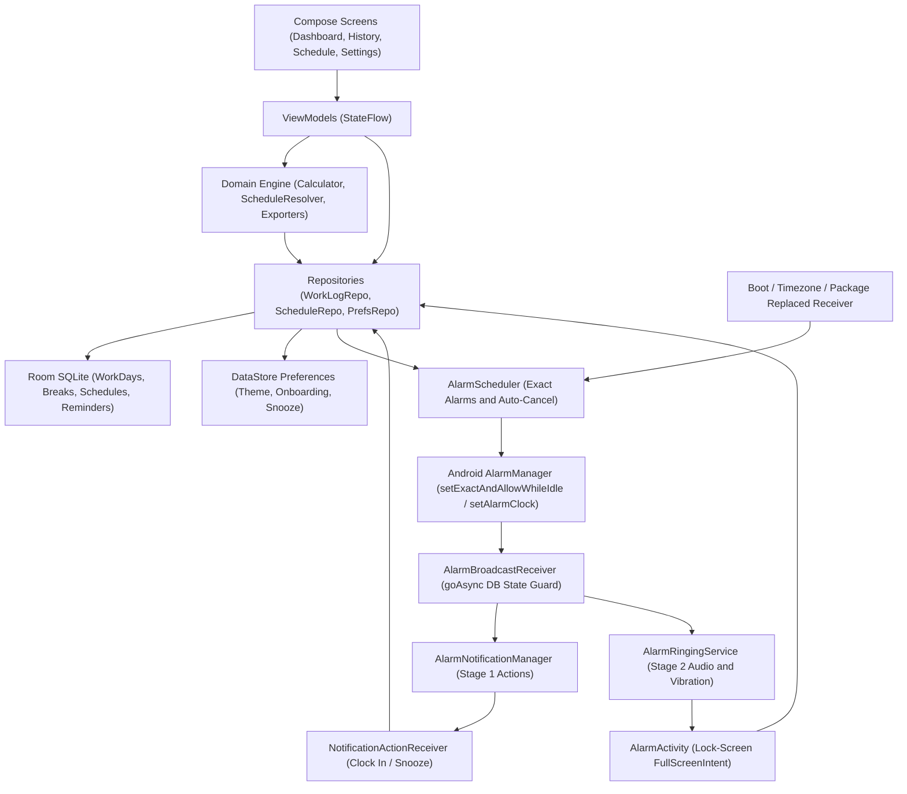

# System Design — WorkHours

> **Architecture:** Offline-First MVVM + Pure Kotlin Domain Layer · **Package:** `com.personal.workhours` · **Persistence:** Room SQLite + Preferences DataStore

---

## 1. High-Level Architecture

The application follows a clean, pragmatic 4-layer architecture without unnecessary framework boilerplate (manual `AppContainer` dependency injection via `Application` subclass):

1. **UI Layer (`ui/`):** Jetpack Compose screens + `StateFlow`-backed `ViewModel`s. Observes reactive streams from repositories and dispatches user actions.
2. **Domain Layer (`domain/`):** Pure Kotlin business logic (`WorkDurationCalculator`, `WorkDayStateResolver`, `ScheduleResolver`, `CsvExporter`, `BackupSerializer`) using an injected `java.time.Clock` for deterministic unit testing.
3. **Data Layer (`data/`):** Room SQLite database (`WorkHoursDatabase`), DAOs, transactional repositories (`WorkLogRepository`, `ScheduleRepository`), and `PreferencesDataStore` for lightweight user settings.
4. **Alarm & System Layer (`alarm/`):** `AlarmScheduler` (computes next trigger instants from schedule + DB state), `AlarmBroadcastReceiver`, `AlarmRingingService` (Foreground Service for audio + vibration), `AlarmNotificationManager`, and `BootAndTimeChangeReceiver`.

---

## 2. Database Schema (Room SQLite, `version = 1`, `exportSchema = true`)

All timestamps are stored as **UTC epoch milliseconds (`Long`)** paired with a **logical `workDate` string (`YYYY-MM-DD`)** and **zone offset ID** so daylight-saving changes or timezone travel never corrupt past days.

### 2.1 `work_days` Table
| Column | Type | Constraints / Notes |
| :--- | :--- | :--- |
| `id` | `Long` | `PrimaryKey(autoGenerate = true)` |
| `workDate` | `String` | `UNIQUE` index, ISO-8601 `YYYY-MM-DD` |
| `clockInEpochMs` | `Long?` | Nullable (null when `DAY_OFF` or `MISSED`) |
| `clockOutEpochMs` | `Long?` | Nullable while shift is active (`CLOCKED_IN` / `ON_BREAK`) |
| `isDayOff` | `Boolean` | Default `false`; true when skipped/holiday |
| `autoDeductBreakMinutes` | `Int` | Default `0`; snapshotted from preference when shift closes without manual breaks |
| `note` | `String` | Default `""`, max 200 chars |
| `updatedAtEpochMs` | `Long` | Last edit timestamp |

### 2.2 `break_sessions` Table
| Column | Type | Constraints / Notes |
| :--- | :--- | :--- |
| `id` | `Long` | `PrimaryKey(autoGenerate = true)` |
| `workDayId` | `Long` | `ForeignKey(WorkDayEntity, onDelete = CASCADE)`, indexed |
| `startEpochMs` | `Long` | Non-null |
| `endEpochMs` | `Long?` | Nullable while `ON_BREAK` |

### 2.3 `day_schedules` Table
Pre-seeded with 7 rows (`dayOfWeek`: `1` = Monday ... `7` = Sunday):
| Column | Type | Notes |
| :--- | :--- | :--- |
| `dayOfWeek` | `Int` | `PrimaryKey` (`1..7`, matching `java.time.DayOfWeek.value`) |
| `isWorkDay` | `Boolean` | Default `true` for Mon–Fri, `false` for Sat–Sun |
| `startMinuteOfDay` | `Int` | `0..1439` (default `480` = 08:00 AM) |
| `endMinuteOfDay` | `Int` | `0..1439` (default `1020` = 05:00 PM) |
| `defaultBreakMinutes` | `Int` | `0..480` (default `60`) |
| `targetWorkMinutes` | `Int` | `0..1440` (default `480` = 8h net target) |

### 2.4 `reminder_configs` Table
Pre-seeded with 3 rows (`eventType`: `"TIME_IN"`, `"BREAK_END"`, `"TIME_OUT"`):
| Column | Type | Notes |
| :--- | :--- | :--- |
| `eventType` | `String` | `PrimaryKey` (`TIME_IN`, `BREAK_END`, `TIME_OUT`) |
| `enabled` | `Boolean` | Default `true` |
| `stage1LeadMinutes` | `Int` | Minutes before target (`0`, `5`, `10`, `15`; for `BREAK_END`, minutes before `defaultBreakMinutes` expires) |
| `stage2Enabled` | `Boolean` | Default `true` |
| `stage2DelayMinutes` | `Int` | Grace window after target (`5`, `10`, `15`, `30`) |
| `stage2Mode` | `String` | `"VIBRATE_ONLY"`, `"SOUND_AND_VIBRATE"`, `"FULL_ALARM"` |
| `vibrationPattern` | `String` | `"PULSE"`, `"HEARTBEAT"`, `"URGENT"` |
| `soundUri` | `String?` | Optional user-selected `RingtoneManager` URI; null uses default alarm tone |
| `snoozeMinutes` | `Int` | Default `5` (`5`, `10`, `15`) |

### 2.5 `day_off_overrides` Table
| Column | Type | Notes |
| :--- | :--- | :--- |
| `workDate` | `String` | `PrimaryKey`, ISO-8601 `YYYY-MM-DD` |
| `reason` | `String` | Optional label (e.g., `"Holiday"`, `"Leave"`, `"Skipped"`) |

### 2.6 DataStore Preferences (`workhours_prefs.preferences_pb`)
- `theme_mode`: `"SYSTEM"` | `"LIGHT"` | `"DARK"`
- `onboarding_completed`: `Boolean` (default `false`)
- `auto_deduct_break_enabled`: `Boolean` (default `false`)
- `active_alarm_event`: `String?` + `active_alarm_date`: `String?` (prevents duplicate UI launches)

---

## 3. Data Integrity & Concurrency Invariants

- **Atomic Mutations (`@Transaction`):** Every punch (`clockIn`, `startBreak`, `resumeWork`, `clockOut`, `skipToday`, `saveManualEdit`) executes inside a Room `@Transaction` and immediately triggers `alarmScheduler.reconcileTodayAndUpcoming()` afterwards.
- **Single Active Session Invariant:**
  - `clockIn(now)` fails safely (no-op / returns existing active day) if an open `work_day` (`clockOutEpochMs == null`) already exists.
  - `startBreak(now)` requires an open `work_day` and zero open `break_sessions` (`endEpochMs == null`).
  - `clockOut(now)` automatically closes any open `break_session` at `now` before setting `clockOutEpochMs = now`, guaranteeing no orphaned open breaks.
- **Duration Calculation (`WorkDurationCalculator`):**
  - `grossMs = (clockOutEpochMs ?: nowEpochMs) - clockInEpochMs`
  - `manualBreakMs = sum((break.endEpochMs ?: nowEpochMs) - break.startEpochMs)`
  - `effectiveBreakMs = if (manualBreakMs > 0) manualBreakMs else autoDeductBreakMinutes * 60_000L`
  - `netWorkMs = max(0L, grossMs - effectiveBreakMs)`
- **Overnight Unclosed Shift Handling:** If the app finds a `work_day` with `workDate < today` and `clockOutEpochMs == null`, the Dashboard surfaces an unresolved-shift card instead of silently auto-closing or blocking permanently.

---

## 4. Two-Stage Escalating Alarm Engine

### 4.1 Trigger Logic & Scheduling
`AlarmScheduler.reconcileAll()` runs on app start, after every punch, after any schedule/reminder edit, and on `BOOT_COMPLETED` / `TIME_CHANGED` / `TIMEZONE_CHANGED`:

1. **For `TIME_IN` and `TIME_OUT`:**
   - Look ahead across the next **7 days** to find the next active workday not listed in `day_off_overrides` where the corresponding punch has not already happened today.
   - Compute `stage1TriggerMs = scheduledTimeMs - (stage1LeadMinutes * 60_000L)`.
   - Compute `stage2TriggerMs = scheduledTimeMs + (stage2DelayMinutes * 60_000L)`.
2. **For `BREAK_END`:**
   - Scheduled **dynamically** only when `startBreak(now)` runs:
   - `targetEndMs = now + (schedule.defaultBreakMinutes * 60_000L)`
   - `stage1TriggerMs = targetEndMs - (stage1LeadMinutes * 60_000L)`
   - `stage2TriggerMs = targetEndMs + (stage2DelayMinutes * 60_000L)`
   - Cancelled immediately when `resumeWork()` or `clockOut()` runs.

### 4.2 Exact Alarm APIs & Notification Channels
- **Stage 1 (Gentle Notification):** Scheduled via `AlarmManager.setExactAndAllowWhileIdle(RTC_WAKEUP, ...)` (falling back to `setAndAllowWhileIdle` if exact alarm permission is revoked). Posts to `channel_reminders_gentle` (`IMPORTANCE_HIGH`) with inline action buttons:
  - `[Clock In]` / `[Resume]` / `[Clock Out]` (executes via `NotificationActionReceiver` without needing to open the app)
  - `[Snooze Xm]` (cancels pending Stage 2 and schedules a snoozed Stage 1/2)
- **Stage 2 (Escalated Vibration / Full Alarm):** Scheduled via `AlarmManager.setAlarmClock(AlarmClockInfo(triggerMs, showIntent), pendingIntent)` so Android treats it as a high-priority user alarm (bypasses Doze and displays the system alarm icon).
- **Mandatory DB-Guard Before Firing:** When `AlarmBroadcastReceiver.onReceive()` fires, it calls `goAsync()`, opens Room on `Dispatchers.IO`, and checks whether the target event is **still needed** (e.g., not already clocked in, not on break-ended, not marked `Day Off`). If already satisfied, it exits silently with zero user interruption.

### 4.3 `AlarmRingingService` & `AlarmActivity`
- Stage 2 starts `AlarmRingingService` (`foregroundServiceType="mediaPlayback"`):
  - **Audio (`USAGE_ALARM`):** Uses `MediaPlayer` configured with `AudioAttributes.USAGE_ALARM` and `CONTENT_TYPE_SONIFICATION` (respects Alarm volume slider, plays even when media/ringer is muted if `FULL_ALARM` or `SOUND_AND_VIBRATE`).
  - **Vibration:** Uses `VibratorManager` / `Vibrator` with `VibrationEffect.createWaveform(...)` and `AudioAttributes.USAGE_ALARM` (`PULSE`, `HEARTBEAT`, or `URGENT` arrays).
  - **Bounded Wake Lock & Safety Auto-Stop:** Acquires a partial `WakeLock` with a hard **5-minute timeout** (`5 * 60_000L`). If unanswered after 5 minutes, the service stops ringing, leaves a sticky `"Missed Reminder"` notification, and releases the wake lock to prevent battery drain.
  - **Lock-Screen UI (`FULL_ALARM`):** Launches `AlarmActivity` via `NotificationCompat.Builder.setFullScreenIntent(...)` on `channel_reminders_alarm` (`IMPORTANCE_HIGH`, bypass DND where user-permitted).

### 4.4 Deterministic `PendingIntent` Request Codes
Every scheduled intent uses a fixed unique request code so `PendingIntent` updates and cancellations never collide:
- `101` = `TIME_IN` Stage 1 · `102` = `TIME_IN` Stage 2
- `201` = `BREAK_END` Stage 1 · `202` = `BREAK_END` Stage 2
- `301` = `TIME_OUT` Stage 1 · `302` = `TIME_OUT` Stage 2
- `401` = Snooze Trigger · `999` = Settings Test Alarm

---

## 5. Export & Backup Architecture (Offline & Safe)

- **CSV Export (`CsvExporter`):**
  - Uses Android Storage Access Framework (`ActivityResultContracts.CreateDocument("text/csv")`) + optional `FileProvider` share sheet.
  - Columns: `Date,Status,ClockIn,ClockOut,BreakMinutes,NetWorkedHours,TargetHours,DeltaHours,Note`.
  - **Formula-Injection Protection:** Any cell value starting with `=`, `+`, `-`, `@`, `\t`, or `\r` (outside numeric columns) is prefixed with `'` before RFC-4180 quoting so spreadsheet apps cannot execute formulas.
- **JSON Backup & Restore (`BackupSerializer`):**
  - Versioned payload: `{ "schemaVersion": 1, "exportedAtEpochMs": ..., "workDays": [...], "breakSessions": [...], "daySchedules": [...], "reminderConfigs": [...], "dayOffOverrides": [...] }`.
  - Restore validates file size (`<= 5 MB`), `schemaVersion == 1`, valid ISO dates, and timestamp invariants (`clockOut >= clockIn`, `breakEnd >= breakStart`) before applying an all-or-nothing Room `@Transaction` replacement and re-running `AlarmScheduler.reconcileAll()`.
